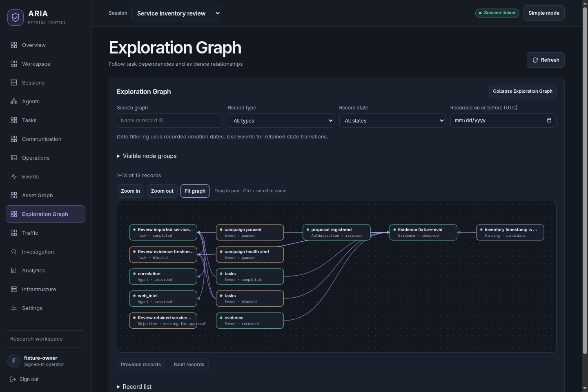
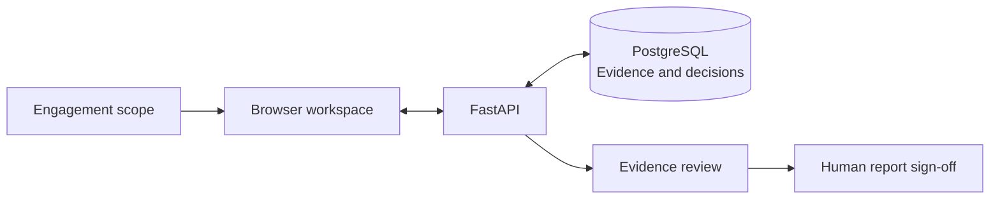

# ARIA

**AI-assisted security assessment for authorized environments**

ARIA brings engagement scope, saved observations, specialist reviews, and report drafts into one browser workspace. Researchers can see what supports a claim, what still needs review, and what is ready to sign off.

[Run locally](#run-aria-locally) · [How it works](#how-it-works) · [Development](#development)



*Mission Control 2.0 development preview, captured in Chromium with sample records. The default branch serves the original browser workspace.*

## How it works



- **Work within scope.** ARIA checks identity, ownership, and engagement scope on the server.
- **Follow the evidence.** Keep observations, specialist conclusions, and reviewed findings linked to their source records.
- **Review before sharing.** Check supporting evidence and unresolved work before signing off on a report.

## Run ARIA locally

Use **Python 3.11** and a **new local PostgreSQL database**. Redis is optional. The basic browser workspace runs without a model key or an execution worker.

### 1. Install

```bash
git clone https://github.com/Hrr-Yassin/ARIA.git
cd ARIA
bash setup.sh
source .venv/bin/activate
```

### 2. Configure

Create an empty PostgreSQL database and a role with permission to create its schema. Create a private `.env` in the project root. Replace each value in angle brackets with your own value.

```dotenv
DATABASE_URL=postgresql+asyncpg://<user>:<password>@127.0.0.1:5432/<database>
SECRET_KEY=<signing-key>
FERNET_KEY=<encryption-key>
KALI_AGENT_TOKEN=<worker-authentication-token>
```

Generate the signing key, worker token, and encryption key with these two commands. Save the values in `.env` and keep them stable across restarts.

```bash
python -c 'import secrets; print("SECRET_KEY=" + secrets.token_hex(32)); print("KALI_AGENT_TOKEN=" + secrets.token_hex(32))'
python -c 'from cryptography.fernet import Fernet; print("FERNET_KEY=" + Fernet.generate_key().decode())'
```

### 3. Start

```bash
python -m alembic upgrade head
python -m api.bootstrap_admin
python -m uvicorn api.main:app --host 127.0.0.1 --port 7000 --workers 1
```

Open [ARIA at 127.0.0.1:7000](http://127.0.0.1:7000/login) and sign in with the administrator you created. Use one API process because some live state is process-local. Back up and verify existing databases before migrating them.

## Development

```bash
python -m unittest discover -s tests -t . -q
node tests/frontend_contracts.cjs
```

Use disposable PostgreSQL and Redis for service integration. The development preview has separate browser and database validation records. [Recorded validation](https://github.com/Hrr-Yassin/ARIA/blob/4240203917012c31dc3be4e1c0f407b8dc10c50b/PROGRESS.md)

[Project documentation](docs/) · [Coding agent guide](AGENTS.md) · [CI checks](.github/workflows/ci.yml)
