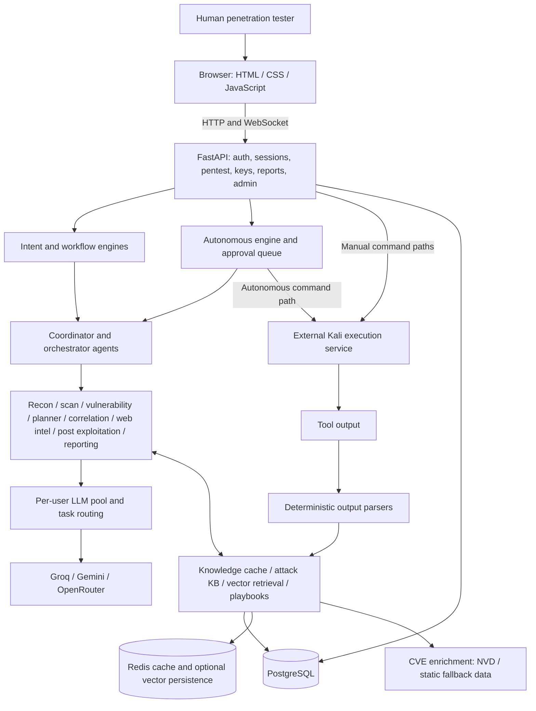
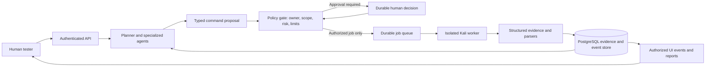

# ARIA — Human–AI Collaborative Penetration Testing

ARIA (`pentest-ai`) is an academic proof of concept for a penetration tester working with specialized AI agents. It combines a browser interface, a FastAPI backend, shared investigation memory, external language models, and a separate Kali execution service.

The research question is whether specialized agents, structured tool evidence, and explicit human decisions improve an authorized assessment's quality, efficiency, and traceability.

**Current status:** prototype under integration. The repository contains substantial implementation, but the current frontend/backend contracts and several security controls are incomplete. It is not ready for an exposed or production deployment. See [technical_revow.md](technical_revow.md) for the evidence, limitations, and remediation backlog. Features described as proposed below are evaluation targets, not verified guarantees of this release.

## Current architecture



The diagram shows the implemented components and intended connections. Some connections are incomplete or inconsistent: execution paths do not share one policy gate; vector persistence is not wired into application startup/shutdown; automatic playbook saving and the standalone ReAct loop are not connected to the main workflow.

### Component responsibilities

| Directory | Responsibility | Main entry points |
| --- | --- | --- |
| `api/` | HTTP/WebSocket API, JWT authentication, session access, administration, reports | `main.py`, `auth.py`, `session_access.py`, `routers/` |
| `agents/` | Coordinate the investigation and specialize reasoning by task | `coordinator_agent.py`, `orchestrator_agent.py`, `autonomous_engine.py`, `base_agent.py` |
| `orchestrator/` | Deterministic intent recognition, phase progression, risk heuristics | `intent_engine.py`, `workflow_engine.py`, `risk_scorer.py` |
| `memory/` | SQL models, session persistence, evidence parsing, investigation state and retrieval | `database_models.py`, `session_manager.py`, `parsers.py`, `attack_knowledge_base.py` |
| `llm/` | Provider adapters, encrypted API-key handling, task routing and failover | `pool_manager.py`, `groq_client.py`, `gemini_client.py`, `openrouter_client.py` |
| `config/` | Environment settings, tool metadata and CVE enrichment | `settings.py`, `tools_registry.py`, `cve_enricher.py` |
| `web/` | Login, tactical workspace and administrator interface | `index.html`, `login.html`, `admin.html`, `static/` |

PostgreSQL stores users, provider keys, sessions, findings, chats, audit records, decision logs, and playbooks. Redis caches sessions and supports optional embedding storage. Attack graphs, live approvals, run state, and much of the investigation memory currently live in Python process memory. PostgreSQL persistence therefore does not imply complete run recovery.

The Kali execution service is an external dependency: its server implementation, tool installation, authentication contract, and sandbox are **not included** in this repository.

## Proposed architecture to evaluate

Keep a modular application with a separate execution worker. Multiple microservices are unnecessary for the initial academic evaluation. Separate planning from authorization and execution through a single, explicit boundary:



1. **Authenticate and scope the engagement.** Resolve the current user from the database, verify session ownership, define explicit targets/exclusions, and assign an engagement policy.
2. **Generate a typed proposal.** Agents propose a tool, structured arguments, target, evidence references, purpose, and risk rationale. Model text is untrusted input.
3. **Apply one server-side policy gate.** Every manual, WebSocket, autonomous, modified, or replayed command passes the same owner, target, tool, risk, timeout, and concurrency checks. Unknown cases require approval or are rejected.
4. **Record human authorization.** Bind approval to an immutable command digest, user, session, expiry, and policy revision. Modification invalidates the old approval and triggers validation again.
5. **Execute in isolation.** An unprivileged worker accepts authenticated jobs, enforces network scope locally, and returns a job ID, exit status, bounded output, and evidence hashes. Cancellation must terminate the remote process.
6. **Persist evidence and events.** Store findings, command outcomes, decisions, and state transitions before notifying clients. Redis accelerates access but is not the source of truth for authorization.
7. **Replan and report.** Deterministic parsers update the evidence model; agents explain recommendations using that evidence. Human verification remains distinct from model confidence.

The API, execution worker, target network, database, and external model providers are separate trust boundaries. Redact passwords, tokens, and customer data before model calls. Retrieval must filter by engagement ownership; sharing playbooks across users requires explicit, sanitized publication.

## Evaluation protocol

Use only isolated, authorized targets with a resettable baseline and a known finding set. Freeze the source revision, target image, tool versions, model identifiers, prompts, and configuration for every experiment.

Compare three conditions on the same scenarios: human with tools; human with a single AI assistant; human with ARIA's specialized agents. Repeat runs, record the number of trials and variability, and keep the time budget and starting evidence comparable. Report limitations caused by model nondeterminism and target selection.

| Dimension | Measurement | Evidence / acceptance criterion |
| --- | --- | --- |
| Finding quality | Precision = verified true positives / reported positives; recall = found ground-truth findings / all ground-truth findings | Findings mapped to independently verified ground truth; publish false positives and misses |
| Efficiency | Wall-clock time to first verified finding and completion; tool calls; model tokens and cost | Timestamped command/model records; compare all three conditions |
| Collaboration | Approval count, rejected/modified proposals, human intervention time | Decisions linked to the exact command and final outcome |
| Scope enforcement | Attempts blocked across REST, WebSocket, autonomous execution and modified approvals | Zero out-of-scope executions in the test set; test enforcement at API and worker |
| Approval enforcement | Critical actions executed without a valid, matching approval | Zero bypasses, including replay, concurrent requests and restart recovery |
| Traceability | Executed jobs with a complete linked proposal, policy result, human decision if required, and outcome | 100% completeness in evaluation runs; missing events are failures |
| Reliability | Recovery after API restart, worker failure, Redis loss, model timeout, and duplicate delivery | No duplicate execution; durable status and evidence remain consistent |
| Report quality | Reproducible evidence, correct scope, severity justification and actionable remediation | Blind review with a declared rubric; distinguish confirmed from suspected issues |

No benchmark results or security certification are claimed by this repository. Establish the integration and security acceptance tests before evaluating autonomous execution.

## Local development

Use an isolated lab. A Python 3.11 virtual environment is a practical starting point for the existing pins; a full supported-version matrix has not been established. PostgreSQL is required. Redis is optional according to the code, but both cache-present and cache-absent behavior need testing.

```bash
git clone git@github.com:Hrr-Yassin/ARIA.git
cd ARIA
python3.11 -m venv .venv
source .venv/bin/activate
python -m pip install -r requirements.txt
```

`sentence-transformers` and NumPy are listed in `requirements.txt`. The implementation has a keyword fallback when embedding dependencies/model loading are unavailable, but the requirements file still installs those packages. Loading semantic embeddings can download a model and consume additional disk and memory.

Provision a local PostgreSQL database and a dedicated database role. Create an untracked `.env` containing the following values, replacing all placeholders:

```dotenv
SECRET_KEY=<persistent-random-signing-secret>
FERNET_KEY=<persistent-valid-fernet-key>
DATABASE_URL=postgresql+asyncpg://<user>:<password>@127.0.0.1:5432/pentestai
REDIS_URL=redis://127.0.0.1:6379/0
KALI_AGENT_URL=http://<isolated-worker-address>:9000
KALI_AGENT_TOKEN=<worker-authentication-secret>
REPORT_OUTPUT_DIR=./reports
ALLOWED_ORIGINS=["http://127.0.0.1:7000"]
AUTO_RISK_THRESHOLD=green_only
AUTONOMOUS_MAX_STEPS=12
AUTONOMOUS_STEP_TIMEOUT_SECONDS=120
AUTONOMOUS_STEP_DELAY_SECONDS=1.5
DECISION_LOG_ENABLED=true
DEBUG=false
```

Generate the signing secret with `python -c 'import secrets; print(secrets.token_hex(32))'` and the encryption key with `python -c 'from cryptography.fernet import Fernet; print(Fernet.generate_key().decode())'`. Keep the same encryption key across restarts and protect it separately from database backups. An optional `NVD_API_KEY` configures CVE enrichment.

```bash
python -m uvicorn api.main:app --host 127.0.0.1 --port 7000 --workers 1
```

Visit `http://127.0.0.1:7000/login`. Startup creates missing tables and seeds hardcoded demonstration accounts; replace that behavior before using real engagement data. The existing UI has login/session/API mismatches documented in the technical review, so a running server does not currently establish an operational end-to-end workflow.

`/api/health` is a liveness response, not a database, worker, or model readiness check. Table creation uses SQLAlchemy `create_all`, not versioned schema migration. Keep one API worker until process-local state is replaced with durable shared state.

`setup.sh` remains as a legacy Ubuntu installation script for reference. It installs system packages globally and runs the service as root. Prefer the isolated development procedure above; redesign the script before using it for deployment.

## Backend route map

These paths follow `api/main.py` router registration. Several current frontend calls use different paths; this is an open integration defect.

| Purpose | Backend route |
| --- | --- |
| Login / liveness | `POST /api/login`, `GET /api/health` |
| Create / list sessions | `POST /api/session/new`, `GET /api/session/list` |
| User input / tool output | `POST /api/v8/input`, `POST /api/tool-results` |
| Manual execution / chat socket | `POST /api/kali/execute`, `WS /api/ws/chat` |
| Autonomous lifecycle | `/api/pentest/{session_id}/autonomous/{start,stop,status,approvals,approve}` (method depends on action) |
| Autonomous events | `WS /api/pentest/ws/{session_id}/auto` |
| Investigation views | `/api/pentest/{session_id}/{kb-snapshot,decision-log,playbooks}` |
| Provider keys / reports / administration | `/api/keys/`, `/api/report/`, `/api/admin/` |

## Repository maintenance

The obsolete `apply_v10_overlay.sh` and `README_V10.md` were removed during review. They described patching a separate v9 tree, referenced an absent router-additions file, and did not describe this integrated checkout. Git history preserves them. Runtime modules and package initializers were retained; partially wired functionality should be repaired or deliberately retired, not deleted based on filename alone.

Read [technical_revow.md](technical_revow.md) before planning fixes or claiming evaluation readiness. This documentation and cleanup do not themselves remediate the runtime findings.
