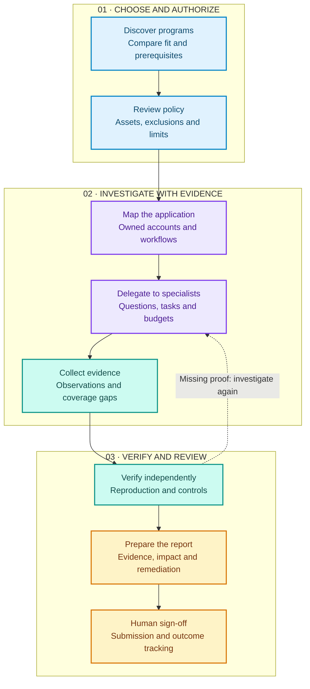
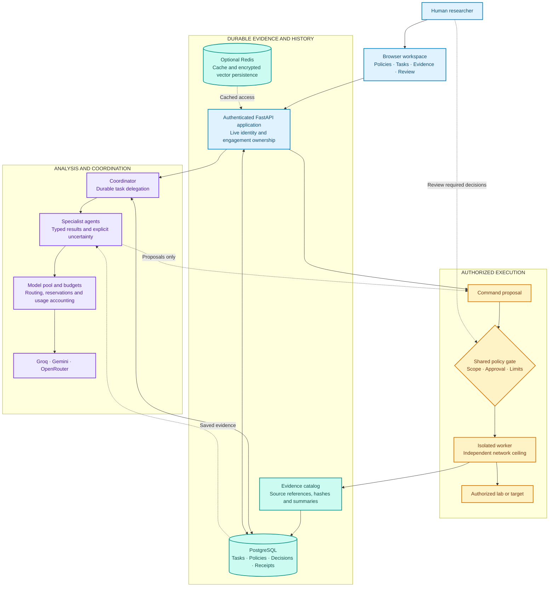
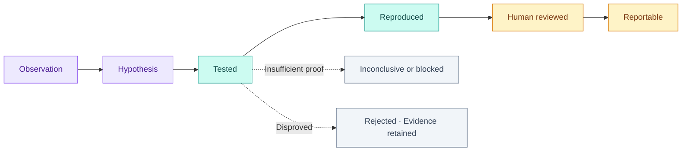
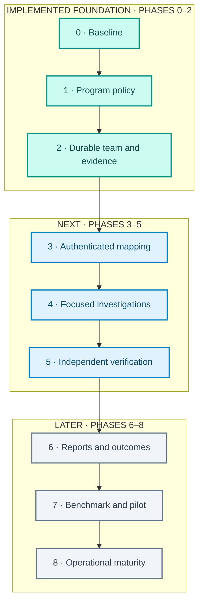

<div align="center">

# ARIA

### An evidence-driven AI team for security research

**Choose the right program. Investigate with a team. Verify the evidence. Review every report.**

A research platform for a human researcher working with specialized AI agents
on authorized web applications and APIs.

[Product roadmap](docs/aria-product-roadmap.md) · [Implementation status](docs/phase2-team-status.md) · [Local setup](#run-aria-locally) · [Documentation](#documentation)

</div>

---

## The project we are building

ARIA aims to bring the full security research workflow into one workspace:
program selection, scope review, application mapping, specialist investigations,
independent verification, and reproducible reports. A researcher directs the work,
approves sensitive actions, and decides what is ready to submit.

The first product focuses on **one researcher, web applications and APIs,
researcher-controlled accounts, bounded execution, and human-reviewed submissions**.
A separate contracted penetration-testing workflow is part of the longer-term plan.

**Today:** Phases 0–2 provide the engineering baseline, reviewed program policies,
and durable team analysis of saved evidence. Phases 3–8 describe the product still
to build. ARIA remains a research prototype; full autonomous vulnerability research
and production readiness have not been established.

## From program policy to a reviewed report

The diagram shows the **planned end-to-end product workflow**. Authenticated
mapping, focused investigation methods, independent finding verification and the
complete submission lifecycle are later roadmap work.



## What ARIA should help you do

| Research need | Product direction | Available today |
| --- | --- | --- |
| Find suitable programs | Compare technical fit, accounts, eligible classes, automation rules and research cost | Private shortlist with visible unknowns and participation prerequisites |
| Understand permission | Turn program policy into reviewed, versioned execution rules | Source-linked review, explicit activation, scope checks and HTTP traffic budgets |
| Organize a research team | Give specialists clear questions, dependencies, evidence and completion criteria | Durable tasks, typed results, owner review and restart blocking without replay |
| Understand the application | Map endpoints, identities, objects, permissions and workflows | Authenticated mapping is planned for Phase 3; selected-capture infrastructure already exists |
| Investigate specific weaknesses | Focus on authorization, sessions, exposure, input handling and business logic | Specialist entry points exist; validated investigation methods are Phase 4 work |
| Separate a clue from a finding | Reproduce behavior, compare controls and reject unsupported conclusions | Evidence catalogs and uncertainty exist; the full verification lifecycle is planned |
| Produce useful reports | Preserve reproduction evidence, review claims and track triage outcomes | Existing report exports; the complete reviewed reporting workflow is planned |

## How the team works

The coordinator gives a specialist a bounded task and collects a structured result.
The researcher can review that result, request more work, or record why a question
remains unresolved. Completing an analysis task does not confirm a vulnerability.

| Role | Responsibility |
| --- | --- |
| **Coordinator and planner** | Turn an objective into tasks, choose specialists, and connect dependencies |
| **Recon and scan** | Gather permitted application and service observations |
| **Web intelligence** | Analyze HTTP evidence, endpoints and authentication clues |
| **Vulnerability analysis** | Form hypotheses and identify missing validation |
| **Correlation** | Compare observations, contradictions and coverage gaps |
| **Reporting** | Assemble evidence and explain findings and limitations |
| **Independent reviewer — planned** | Challenge conclusions and request the smallest missing proof |
| **Human researcher** | Review policy, authorize actions, assess evidence and sign off on deliverables |

Specialist names describe responsibilities. Their presence does not establish
expert-level investigation quality or enable every tool mentioned in a prompt.

## Architecture: one workspace, a controlled execution boundary

ARIA uses a modular FastAPI application and a separate execution worker. This
schematic shows the current foundation. Broader browser/replay capabilities and
an independent finding-verification service are future work.



**Task delegation performs analysis.** It does not automatically execute proposed
commands. Execution uses the shared authorization path, and the worker independently
checks its allowed destinations and ports. Policy import and model output cannot
grant testing permission.

**PostgreSQL holds authoritative records.** Task transitions commit before clients
receive their events. Repeated task delivery does not repeat a specialist call;
restart recovery blocks unfinished work for inspection. Full investigation-memory
restoration and distributed scheduling remain outside the current implementation.

## The evidence standard

The planned verification lifecycle makes the difference between a promising clue
and a reportable finding visible. This lifecycle belongs to **Phases 5–6**;
Phase 2 currently stores observations, hypotheses, uncertainty and human task review.



A successful HTTP response, a matching version, a scanner label, or agreement
between models is not sufficient proof of a vulnerability. Findings need attributable
evidence, reproduction and review. External submission remains a human action.

## Roadmap

The sequence follows acceptance gates rather than promised release dates.
Read the [full roadmap](docs/aria-product-roadmap.md) for individual tasks and dependencies.



| Phase | Outcome | Status |
| --- | --- | --- |
| **0 · Baseline** | Reproducible tests, migration/restore evidence, action-to-report trace and restart checks | Complete for the engineering baseline |
| **1 · Program discovery and scope** | Human-reviewed program policy and bounded HTTP observations | Complete for unauthenticated curl GET/HEAD |
| **2 · Durable team tasks and evidence** | Saved tasks, evidence/coverage ledgers, reviewed specialist results and shared model budgets | Implemented for supervised saved-evidence analysis |
| **3 · Authenticated mapping** | Isolated identities, workflow maps and reviewed HTTP replay | Planned — next development phase |
| **4 · Focused investigations** | Tested specialist methods with positive and negative controls | Planned |
| **5 · Independent verification** | Reproduction, evidence requirements and reviewer decisions | Planned |
| **6 · Reporting and outcomes** | Reviewed deliverables, reproduction attachments and triage tracking | Planned |
| **7 · Benchmark and supervised pilot** | Measured quality, coverage, human effort and cost | Planned |
| **8 · Operational maturity** | Recovery, retention, contracted pentesting and additional reviewed profiles | Planned |

## What works today

The current worker supports **curl and bounded Nmap TCP profiles**. Reviewed
program policies narrow that to **unauthenticated curl GET/HEAD observations**.
Arbitrary shell commands, raw/UDP/NSE scans, authenticated replay and post-access
execution are unavailable. The Burp Community connector remains feature-gated
pending its desktop/runtime acceptance.

Phase 2 acceptance records **177 passing offline Python tests**, **nine synthetic
Firefox checks**, and **seven grouped disposable SQL/worker checks**. These are
engineering results from the documented validation revision, not a vulnerability
benchmark or a production certification. Provider responses were mocked.
See [Phase 2 acceptance](docs/phase2-team-status.md) for exact commands and limits.

## How success will be measured

ARIA's research question is whether specialized agents, shared evidence and explicit
human decisions improve an authorized assessment compared with manual work and a
single AI assistant.

| Measure | What it tells us |
| --- | --- |
| Verified precision and recall | How many reported findings are real, and which known issues were missed |
| Coverage and unresolved questions | What was tested, what remains unknown, and why |
| Independent reproduction | Whether a reviewer can reproduce the result from its evidence |
| Time and human effort | Investigation time, review time and required interventions |
| Requests, tokens and model cost | The resources used to reach a reviewed conclusion |
| Scope and recovery behavior | Whether testing stays authorized and avoids duplicate execution |
| Submission outcomes | Accepted, duplicate, informative, rejected and paid outcomes, tracked separately |

A no-finding investigation can still produce useful coverage and pass engineering
criteria. ARIA does not promise vulnerabilities, bounty acceptance or income.

## Run ARIA locally

Use an isolated, authorized lab. The supported core uses **Python 3.11**, **FastAPI**,
**PostgreSQL**, an optional **Redis** cache, and an HTML/CSS/JavaScript browser UI.
The execution worker runs separately with Docker or Podman.

```bash
git clone git@github.com:Hrr-Yassin/ARIA.git
cd ARIA
python3.11 -m venv .venv
source .venv/bin/activate
python -m pip install --require-hashes -r requirements.txt
python -m pip check
```

Provision PostgreSQL and create a private, untracked `.env`. Keep signing and
encryption keys persistent so saved credentials remain usable after restart.

<details>
<summary><strong>Environment configuration</strong></summary>

Replace every placeholder before starting the application:

```dotenv
SECRET_KEY=<persistent-random-signing-secret>
FERNET_KEY=<persistent-valid-fernet-key>
DATABASE_URL=postgresql+asyncpg://<user>:<password>@127.0.0.1:5432/pentestai
REDIS_URL=redis://127.0.0.1:6379/0
KALI_AGENT_TOKEN=<random-worker-authentication-secret>
KALI_WORKER_PROTOCOL=jobs-v1
REPORT_OUTPUT_DIR=./reports
ALLOWED_ORIGINS=["http://127.0.0.1:7000"]
AUTO_RISK_THRESHOLD=green_only
AUTONOMOUS_MAX_STEPS=12
AUTONOMOUS_STEP_TIMEOUT_SECONDS=120
DECISION_LOG_ENABLED=true
DEBUG=false
```

Generate a signing/worker secret with:

```bash
python -c 'import secrets; print(secrets.token_hex(32))'
```

Generate a persistent encryption key with:

```bash
python -c 'from cryptography.fernet import Fernet; print(Fernet.generate_key().decode())'
```

`KALI_AGENT_URL` is configured separately when the worker is ready. Follow the
[worker setup guide](docs/worker-setup.md) for its separate database, matching token,
reviewed image and network/port ceiling. Redis is optional. Experimental semantic
embeddings are separately provisioned and are outside the supported core lock.

</details>

For a **new, empty database**:

```bash
python -m alembic upgrade head
python -m api.bootstrap_admin
python -m uvicorn api.main:app --host 127.0.0.1 --port 7000 --workers 1
```

Open **http://127.0.0.1:7000/login**. Configure provider keys in the UI, then save
an engagement model budget and conservative tariffs for the exact provider/model
before requesting live analysis. Missing tariffs block model calls.

Use one API worker; parts of investigation state remain process-local. Schema head
is `0003`. For an existing unversioned or populated installation, follow the
[backup, staging and migration-adoption instructions](docs/p2-status.md) before
changing its schema. Local checks do not establish readiness for an exposed deployment.

## Repository map

| Directory | Purpose |
| --- | --- |
| `web/` | Research workspace, policy review and team controls |
| `api/` | Authentication, engagements, tasks, evidence and review endpoints |
| `agents/` | Coordinator, planner and specialist agents |
| `orchestrator/` | Workflow, task delegation and execution policy |
| `memory/` | SQL records, evidence, coverage, authorization and recovery |
| `llm/` | Provider adapters, routing and shared model accounting |
| `worker/` | Separate constrained execution service and job ledger |
| `security/`, `config/` | Credentials, redaction, retrieval controls and settings |
| `migrations/` | Versioned application schema |
| `tests/`, `integration/` | Offline regressions, browser fixtures and disposable acceptance labs |
| `docs/` | Product roadmap, status, validation and lab guides |

## Development checks

```bash
DEBUG=false .venv/bin/python -B -m unittest discover -s tests -t . -q
node tests/frontend_contracts.cjs
git diff --check
```

Offline tests block outbound sockets/DNS and mock providers and workers. Service
acceptance uses disposable resources; see the phase status documents before running
integration commands. CI includes locked installation, offline/frontend regressions,
service checks and container-worker/Phase 2 acceptance.

## Documentation

| Start here | Details |
| --- | --- |
| [Product roadmap](docs/aria-product-roadmap.md) | Complete backlog, dependencies and acceptance gates |
| [Phase 0 baseline](docs/phase0-baseline.md) | Capability inventory, schema, migration/restore and trace evidence |
| [Phase 1 policy status](docs/phase1-policy-status.md) | Program import, owner activation, scope semantics and traffic budgets |
| [Phase 2 team status](docs/phase2-team-status.md) | Durable tasks, evidence, model budgets, setup and acceptance |
| [Worker setup](docs/worker-setup.md) · [Contract](docs/worker-contract.md) | Execution deployment, limits and cancellation guarantees |
| [Security status](docs/security-review.md) · [Original review](technical_revow.md) | Remediation history and remaining limitations |
| [Fedora lab](docs/fedora-lab.md) | Recorded local lab configuration and operation |
| [Browser validation](docs/browser-validation.md) · [Upgrade register](docs/aria-upgrade-validation.md) | Historical workflow checks and feature release gates |

Historical security-remediation P0/P1/P2 labels are separate from the product
roadmap's Phases 0–8. Use each document's stated revision and validation scope.
