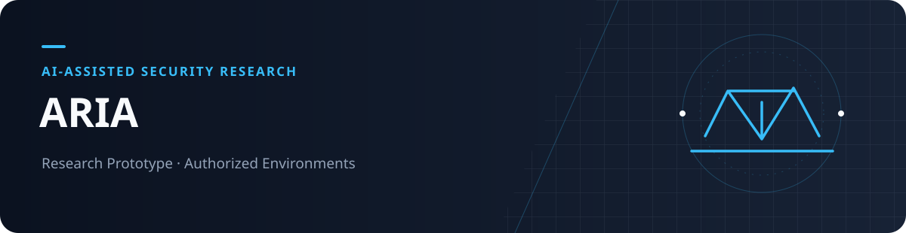
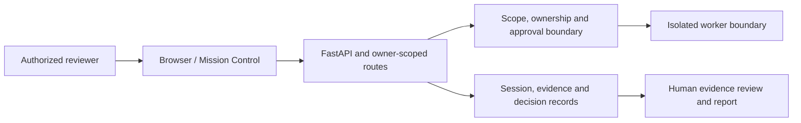
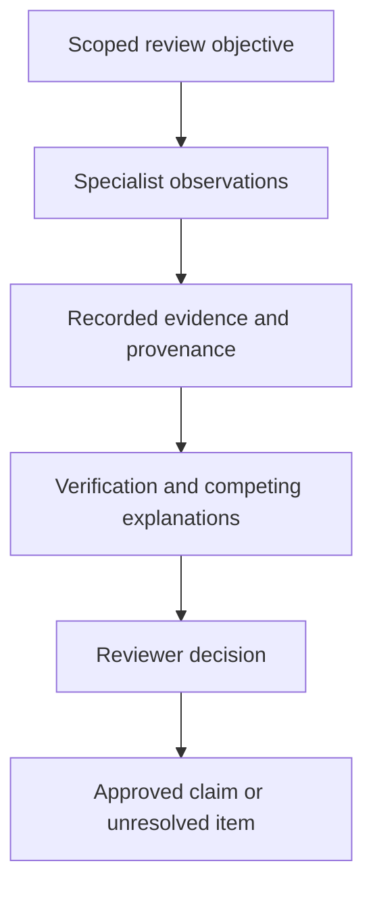
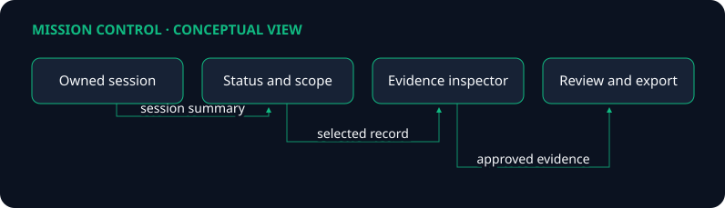

# ARIA

**Research prototype · Authorized security assessment**

ARIA studies how human reviewers can supervise AI-assisted security assessments, inspect what the system observed and trace report claims to evidence. The research focuses on accountable decisions under scope, identity, budget and evidence constraints.

## Branch guide

| Branch | What you can inspect |
| --- | --- |
| [`main`](https://github.com/Hrr-Yassin/ARIA/tree/main) | Default branch. Python/FastAPI backend, browser UI, authorization, evidence and isolated worker contracts. Audited baseline [`37d6cb0`](https://github.com/Hrr-Yassin/ARIA/commit/37d6cb066654e4b00fa18adfe8f2ce3e0da50801). |
| [`evidence-driven-team`](https://github.com/Hrr-Yassin/ARIA/tree/evidence-driven-team) | Repository checkpoint for reviewed findings, reporting and November 7 lab evidence. Audited [`24f3918`](https://github.com/Hrr-Yassin/ARIA/commit/24f3918bf38a1a63519af7249f971979c3b2d226). |
| [`autonoms_pentesters`](https://github.com/Hrr-Yassin/ARIA/tree/autonoms_pentesters) | Advanced development. Mission Control 2.0 and expanded evidence, decision and reliability records. Audited [`4240203`](https://github.com/Hrr-Yassin/ARIA/commit/4240203917012c31dc3be4e1c0f407b8dc10c50b). |

## Research questions

- Can a reviewer see the authorized scope, ownership and basis for a decision?
- Can a report claim be traced to an observation and distinguish supported conclusions from unresolved hypotheses?
- Can the interface represent stale, unavailable and blocked observations explicitly during service or authorization failures?

## System architecture



The Python 3.11 core places HTTP routes in `api/`, specialist modules in `agents/`, policy and coordination in `orchestrator/`, persistence and evidence in `memory/`, and worker services in `worker/`. PostgreSQL and Redis appear in service integration tests. The advanced branch adds TypeScript/Vite for Mission Control and worker adapter definitions under `security_tools/`. Fedora orchestration and a separate Kali worker appear in the advanced branch deployment documentation. These are lab deployment patterns with versioned capability and availability checks.

### Collaboration and evidence



The specialist architecture separates collection and review responsibilities. A reviewable record preserves ownership, evidence source, state and decision context. A signed export and a completed action require their own verification. An acknowledgement alone can still leave containment pending. The [reporting status](https://github.com/Hrr-Yassin/ARIA/blob/4240203917012c31dc3be4e1c0f407b8dc10c50b/docs/phase6-reporting-status.md) describes review, disposition and export evidence.

## Mission Control 2.0



*Conceptual view of the advanced branch.*

Mission Control provides an owner-scoped session picker, read-only status views, evidence inspection, campaign history and replay of retained records. Its contracts distinguish absence, limited access, stale information and service unavailability. Some evidence is bounded by producer retention and browser replay state. Authorization remains server-side. See the [versioned frontend contracts](https://github.com/Hrr-Yassin/ARIA/blob/4240203917012c31dc3be4e1c0f407b8dc10c50b/docs/mission-control-contracts.md).

## Implementation and validation

| Evidence status | Recorded result and scope |
| --- | --- |
| Implemented | `main` contains authentication, execution policy interfaces, evidence persistence, browser UI and worker code. The advanced revision adds the Mission Control bundle, owner-scoped projections and frontend state handling. Source and historical test reports are listed below. |
| Tested offline | On 19 November 2026 the advanced-branch log records **876 Python regressions** passing, five JavaScript suites passing and a successful TypeScript/Vite build. [Dated progress record](https://github.com/Hrr-Yassin/ARIA/blob/4240203917012c31dc3be4e1c0f407b8dc10c50b/PROGRESS.md) |
| Tested in isolated fixtures | The 19 November log records **41/41** checks each in visible Chromium and headless Firefox and a disposable PostgreSQL check. These results cover scoped UI behaviors, authorization, replay and accounting states. [Dated progress record](https://github.com/Hrr-Yassin/ARIA/blob/4240203917012c31dc3be4e1c0f407b8dc10c50b/PROGRESS.md) |
| Verified in a live lab | On 7 November 2026 the evidence branch recorded real local API/database/UI checks for sign-in, engagement state and owner-scoped views. The advanced branch records an authenticated read-only workstation review of ten views on 19 November. [7 November notes](https://github.com/Hrr-Yassin/ARIA/blob/24f3918bf38a1a63519af7249f971979c3b2d226/docs/live-user-testing-2026-11-07.md) · [19 November progress](https://github.com/Hrr-Yassin/ARIA/blob/4240203917012c31dc3be4e1c0f407b8dc10c50b/PROGRESS.md) |
| Blocked or unverified | Raw Mission Control run artifacts referenced under `.local-lab/` are local. Portfolio review did not rerun services, browser fixtures, target activity or model calls. Broader effectiveness and production readiness remain unverified. |
| Planned | Continue policy and availability regression, publish sanitized validation manifests and measure evidence quality and reviewer agreement across bounded lab runs. |

## Reproduce the offline baseline

Use a fresh clone with Python **3.11** and Node.js available. The pinned dependency installation and offline regressions can run without starting ARIA services or configuring an execution target.

```sh
git clone https://github.com/Hrr-Yassin/ARIA.git
cd ARIA
git switch --detach 37d6cb066654e4b00fa18adfe8f2ce3e0da50801
bash setup.sh
.venv/bin/python -B -m unittest discover -s tests -t . -q
node tests/frontend_contracts.cjs
```

[Locked Python dependencies](requirements.txt) · [Security review](docs/security-review.md) · [Main branch offline test source](tests/)

## Authorization and limitations

Use ARIA only in explicitly authorized training or research environments. Keep scope, identity and approval server-side, constrain the worker environment, and keep credentials and raw evidence private. Require a human decision on report conclusions and on any material scope change. Worker health, provider health and remaining budget can independently affect availability. A test pass establishes only the covered behavior, data and environment.

## Project documentation

- [Security review](docs/security-review.md) · [Main worker contract](docs/worker-contract.md) · [Main Fedora lab design](docs/fedora-lab.md)
- [Advanced architecture review](https://github.com/Hrr-Yassin/ARIA/blob/4240203917012c31dc3be4e1c0f407b8dc10c50b/docs/audit/architecture-review.md) · [Frontend contracts](https://github.com/Hrr-Yassin/ARIA/blob/4240203917012c31dc3be4e1c0f407b8dc10c50b/docs/mission-control-contracts.md)
- [Research objectives](https://github.com/Hrr-Yassin/ARIA/blob/4240203917012c31dc3be4e1c0f407b8dc10c50b/GOALS.md) · [Development plan](https://github.com/Hrr-Yassin/ARIA/blob/4240203917012c31dc3be4e1c0f407b8dc10c50b/PLANS.md) · [Progress and source evidence](https://github.com/Hrr-Yassin/ARIA/blob/4240203917012c31dc3be4e1c0f407b8dc10c50b/PROGRESS.md)
- [Prior default-branch README](https://github.com/Hrr-Yassin/ARIA/blob/37d6cb066654e4b00fa18adfe8f2ce3e0da50801/README.md) · [Back to the portfolio](https://github.com/Hrr-Yassin)
