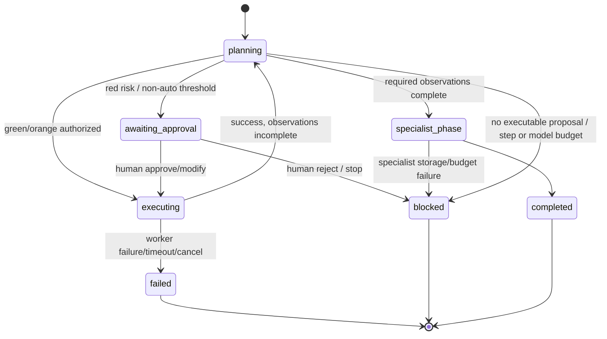
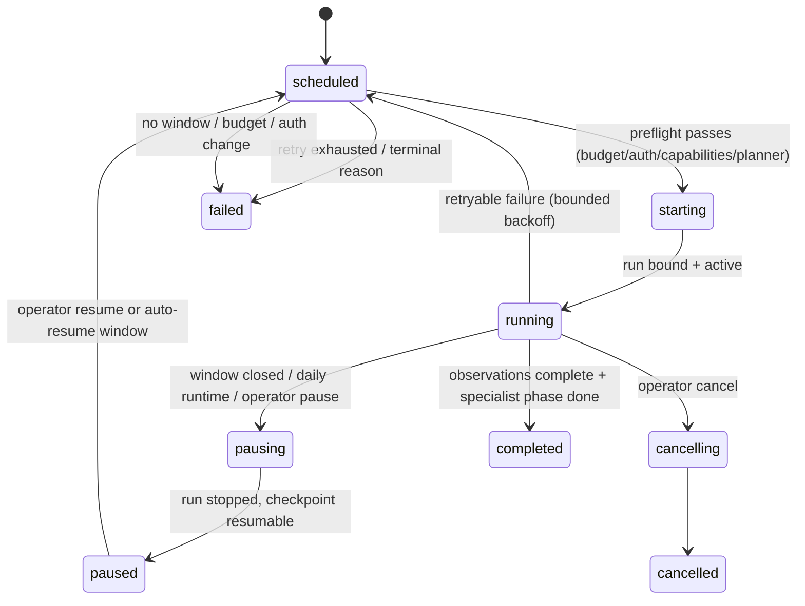
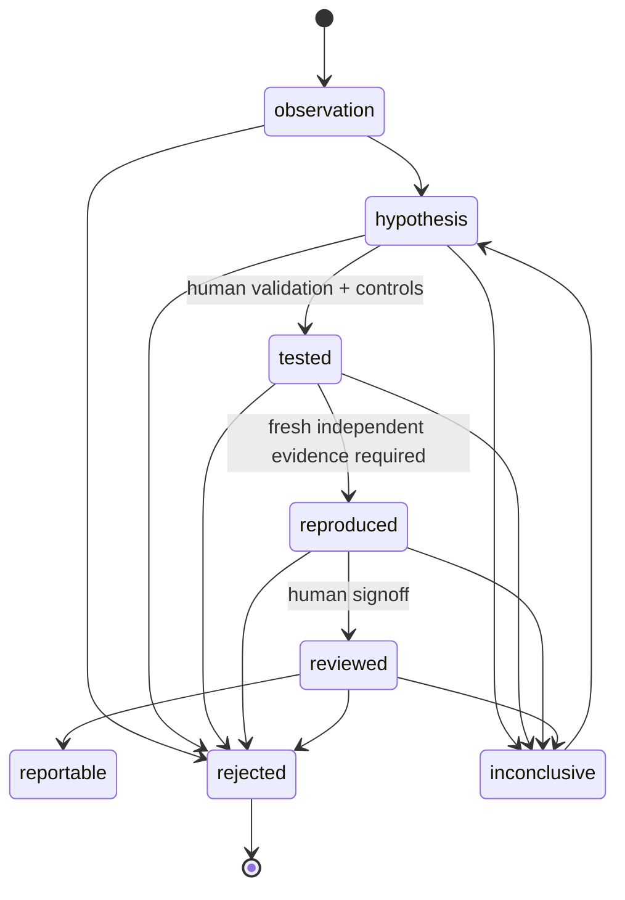

# ARIA — Static Architecture Audit (Phase A)

Audit date: 2026-11-13.
Branch: `autonoms_pentesters`
HEAD (verified at audit start): `2fd16db72406a41fc7370537b80d4cb7f7d71bac` — matches the reference commit; no reset or overwrite was performed.

Method: every claim below was verified against source at the stated `file:line`. Claims that could not be verified are labeled **NOT DEMONSTRATED**. Statements taken only from project documentation are labeled **doc-claimed, unverified**. No live scans, model calls, or target traffic were produced by this audit.

Companion documents: `agent-capability-matrix.md`, `execution-paths.md`, `model-context-and-cost.md`, `implementation-roadmap.md`, `acceptance-matrix.md`.

---

## 1. Executive summary

ARIA is a Python 3.11 / FastAPI / PostgreSQL research prototype whose security architecture is, on inspection, **substantially more disciplined than its marketing-flavored docstrings suggest**. The "autonomous pentester" is in reality a small, heavily bounded system:

- **One bounded execution loop** (`agents/autonomous_engine.py`) that repeatedly asks an LLM planner for a single command, validates it through a shared command-bound authorization gate, dispatches it to an **isolated Docker worker that supports only `curl` and TCP-connect `nmap`**, parses output deterministically, and persists bounded observations. Supported goals: `discovery`, `http_check` only (`autonomous_engine.py:304`).
- **No unrestricted agent-to-agent messaging.** Specialist "collaboration" is a durable task ledger (`memory/team_tasks.py`) where a coordinator dispatches review-only tasks to specialist LLM roles; every result is stamped unverified until human review (`orchestrator/team_coordinator.py:120-121`).
- **A durable campaign supervisor** (`orchestrator/campaign_supervisor.py`) schedules bounded runs inside 8-hour daily windows on configured weekdays, under PostgreSQL leases, with retry/backoff, pause/resume/cancel, and fail-closed preflight.
- **Durable, fail-closed model accounting** (`llm/engagement_budget.py`): per-call reservations committed to SQL *before* provider I/O, never refunded, with unknown-usage and overrun states that stop further calls.
- **Strong isolation chain for execution**: command policy (allowlisted argv reconstruction) → engagement scope intersection with an independent worker network ceiling → DNS resolution pinned at admission → in-container nftables allowlist → Docker container with dropped capabilities, read-only root, CPU/memory/PID/ulimit caps (`worker/runtime.py:71-79`, `worker/policy.py:113-125`).

**Where the system is honestly weak** (documented, not hidden): only two tools are executable; exploitation goals (`initial_access`, `dump_creds`, `privilege_escalation`, `full_compromise`) are recognized by the goal checker (`autonomous_engine.py:1539-1556`) but **cannot be started** — `_start` blocks with `unsupported_goal` (`autonomous_engine.py:304-307`); eight-hour endurance is validated only by accelerated synthetic harnesses (**docs/spec15-endurance-status.md** says so explicitly); the scientific benchmark has a deterministic component baseline but **no measured manual / single-assistant / ARIA comparison** (`evaluation/benchmark.py:157-162`); there is no prompt caching anywhere in `llm/`; browser automation is an optional API-side Playwright renderer for saved evidence, not a containerized browser worker profile.

---

## 2. Layer inventory (verified)

### 2.1 `api/` — transport, auth, admin

FastAPI application in `api/main.py`; routers in `api/routers/` (admin, api_keys, application_map, burp, pentest, programs, reports, sessions, team, tool_registry). Authentication is JWT/cookie via `api/auth.py` with revision-based revocation (`api/session_access.py`). A dedicated middleware validates engagement scope (`api/middleware/scope_validator.py`). Admin bootstrap is interactive (`api/bootstrap_admin.py`). See the route/authorization inventory in §5 and `execution-paths.md` §4.

### 2.2 `agents/` — LLM roles, not processes

All agents are `BaseAgent` subclasses executed in-process. `BaseAgent.__init_subclass__` (`agents/base_agent.py:50-148`) wraps **every** specialist `process()` with a common boundary: session-ownership check, evidence filtering to owner/session, evidence selection by relevance, worker capability read (3 s timeout), redaction, and a `professional_result` contract. Private reasoning fields (`reasoning_chain`, `chain_of_thought`, `react_trace`…) are stripped from public output (`base_agent.py:122,200-204`).

| Agent | Role in reality | Key file |
| --- | --- | --- |
| `orchestrator_agent` | Planner for the autonomous loop (`_bounded_assessment_plan`) and interactive planning | `agents/orchestrator_agent.py:126-158` |
| `coordinator_agent` | Legacy coordinator role | `agents/coordinator_agent.py` |
| `recon_agent`, `scan_agent`, `vuln_agent`, `web_intel_agent`, `correlation_agent`, `report_agent` | Specialist LLM roles invoked only via the team task ledger | `agents/*.py` |
| `post_exploitation_agent` | Hard-stubbed: returns "Post-access work requires verified access…" without any LLM call (`base_agent.py:107-108`) | `agents/post_exploitation_agent.py` |
| `attack_planner_agent` | Planner alternative role | `agents/attack_planner_agent.py` |
| `autonomous_engine` | The bounded run loop + checkpoint restore (not a `BaseAgent`) | `agents/autonomous_engine.py` |

Details in `agent-capability-matrix.md`.

### 2.3 `orchestrator/` — policy and coordination

- `execution_policy.py` — conservative allowlisted argv parser. Unknown syntax rejected, shell chaining/metacharacters refused (`:104-105`), per-tool FLAGS table (`:24-39`), target must lie in engagement scope (`allowed_target`, `:68-83`), Metasploit restricted to one reviewed module with explicit targets (`:124-157`).
- `workflow_engine.py` — phase bookkeeping. **Automatic phase advancement is disabled** (`suggest_next_phase` returns `None`, `:104-107`); readiness requires human-reviewed tasks (`evidence_readiness`).
- `specialist_integration.py` — deterministic review-task selection from durable evidence (SPEC-13).
- `specialist_investigations.py` — investigation templates + capability gating.
- `team_coordinator.py` — durable task claim → specialist dispatch → collect. **Never dispatches tools.**
- `campaign_execution.py` — `require_campaign_execution()`: campaign-bound tasks may run only under a live supervisor lease with matching ownership, state, scope digest, auth revision, worker epoch (`:50-161`).
- `campaign_supervisor.py` — lease-guarded scheduler (SPEC-12).
- `intent_engine.py`, `program_scope.py`, `risk_scorer.py`, `browser_mapping.py` — intent classification, program-policy scoping, risk classification, optional browser rendering of saved evidence.

### 2.4 `memory/` — persistence and evidence

- `database_models.py` — SQLAlchemy models. `DecisionLog` doubles as the immutable event store for: execution authorizations, model attempts, knowledge observations, campaign/team events (`memory/execution_authorization.py:45-80`, `llm/engagement_budget.py:184-191`).
- `execution_authorization.py` — the **single execution gate**: `propose` validates the command against engagement scope and stores a `Proposal` (pending if red-risk or approval required, else authorized); `execute` requires a proposal whose status is `approved`/`authorized`, re-validates the exact command, consumes the authorization with a compare-and-swap **before** contacting the worker (`:169-210`), and re-checks the proposal inside the worker call (`_worker`, `:212-228`).
- `knowledge_store.py` — append-only owner-bound observations keyed by job receipt; bounded structured facts + SHA-256 evidence hashes only; raw output/commands/credentials excluded (`:1-8`).
- `campaign_store.py` — durable campaign rows, lease transitions, budget ledger, event ring.
- `autonomous_runs.py` — run checkpoints with replay guards (`command_digest`, executed-command hashes).
- `application_map.py`, `web_actions.py`, `burp_community.py` — private application map (sealed), authenticated-web action ledger, Burp connector.
- `finding_verification.py` — human-driven verification state machine: `observation → hypothesis → tested → reproduced → reviewed → reportable` with mandatory positive/negative controls and fresh-source reproduction (`:9-19,163-174`).
- `attack_knowledge_base.py`, `knowledge_cache.py`, `vector_store.py` — in-process KB + cross-session similarity retrieval.
- `team_tasks.py` — immutable team task/evidence ledger (SPEC-13 base).
- `campaign_observability.py` — SPEC-14 health/events/accounting monitor.

### 2.5 `worker/` — the only execution environment

- `runtime.py` — Docker/Podman CLI runtime. Requires immutable `sha256:` image ID and private bridge network (`:16-20`); containers run read-only, 1 CPU, 256 MiB memory+swap, 64 PIDs, `--cap-drop=ALL`, `no-new-privileges`, noexec tmpfs, bounded logs (`:71-79`). Protected-HTTP jobs get a one-use key file mounted from a private host directory (`:80-93`).
- `policy.py` — worker-side command policy: only `curl` and TCP-connect `nmap`; injects `-sT -Pn -n` for nmap (`:56-62`); intersects engagement scope with an independent ceiling (`networks`, `ports`); resolves DNS at admission and pins addresses (`resolve`); generates a per-job **nftables output-filter allowlist** (`firewall`, `:113-125`).
- `service.py` — durable admission: fingerprint-bound idempotency (`fingerprint`, `:14-15`), engagement fences, rate/overload stops for program traffic and authenticated HTTP, private-evidence retention, verified cancellation, never-replay recovery (`recover`, `:197-201`).
- `http_profile.py` / `http_runner.py` — the `aria-http` authenticated replay profile: exact integer protocol versions, encrypted request binding, 10 s deadline.
- `ownership.py` — local `flock`-based single-controller lock.
- `container_entry.py` — trusted entrypoint: installs firewall, drops to uid 65534.

### 2.6 `llm/` — model access

`pool_manager.py`: per-user encrypted provider keys (Fernet), tiered task→provider/model routing (`TASK_MODEL_MAP`, `:65-107`), two-pass failover, per-key quotas/cooldown, **redaction of deployment secrets and known credentials from every prompt** (`:278-289`), read-only `planner_preflight` admission check. Provider adapters: `groq_client.py`, `gemini_client.py`, `openrouter_client.py`, `local_client.py`. `engagement_budget.py`: durable reservations/settlement (see §6.3). `validation_budget.py`: bounded per-task validation. **No prompt caching exists in any provider path** (grep for cache-control across `llm/` finds nothing). Full analysis: `model-context-and-cost.md`.

### 2.7 `config/`, `security/`, frontend

`config/tools_registry.py` + `security_tool_registry.py` are **name/catalog registries, not installed or executable tools** (they drive UI listings, risk coloring, CVE metadata). Only `curl`/`nmap`/`aria-http` have working worker adapters — verified in `worker/policy.py:38-53`. `security/` holds credential revisioning, encryption, login throttling, program-policy fetch, and redaction. Frontend is static HTML + vanilla JS (`web/`, ≈4.9 kLOC); the workspace drives the API listed in `execution-paths.md` §4.

---

## 3. Verified execution paths (summary)

Full traces with file:line in `execution-paths.md`.

1. **Interactive chat/plan → proposal → approval → worker** — `POST /api/v8/input` → `orchestrator_agent.process` → `execution_authorization.propose/decide/execute` → `worker_jobs` (jobs-v1) → Docker container.
2. **Bounded autonomous run** — `POST /api/pentest/{id}/autonomous/start` (or campaign supervisor) → `AutonomousEngine._run_loop`: goal check → `_plan_next_step` (LLM, ≤3 corrective attempts) → `_validated_plan` (server-side re-validation of the planner's command against worker policy) → `propose` → red-risk human approval hard-block → `execute` → deterministic parse → `knowledge_store.record_observation` → repeat; completes only on **durable worker receipts** for the goal's required observations (`autonomous_engine.py:82-123,890-1135`).
3. **Durable campaign** — supervisor tick → lease claim → preflight (budget, authorization context, worker capabilities, planner preflight) → engine start/restore → per-tick safety re-checks → pause/resume/cancel → retry with backoff (`campaign_supervisor.py:151-229,426-539`).
4. **Specialist review phase (SPEC-13)** — after observation completion, campaign-bound runs select deterministic review tasks from durable evidence (`specialist_integration.select_candidates`), ensure them in the team ledger, and run at most 3 (`SPECIALIST_MAX_TASKS_PER_RUN`), each under lease revalidation; results are hypotheses (`team_coordinator.run`), never verified findings.
5. **Finding verification (SPEC-14 area)** — entirely human-driven state machine over cataloged evidence with positive/negative controls (`finding_verification.py`).
6. **Report generation** — `report_agent` + `professional_reports.py`, evidence-manifested.

## 4. Security boundary analysis

| Boundary | Mechanism (verified) | Residual risk |
| --- | --- | --- |
| Command policy | Allowlisted argv reconstruction; shell metacharacters refused; unknown tools rejected (`execution_policy.py:104-205`); worker re-validates and further restricts (`policy.py:38-62`) | Policy tables must stay in sync between API and worker — worker is authoritative, so drift fails closed (good). `searchsploit` and `whois`/`dig`/`host`/`ping` pass API policy but are **rejected by the jobs worker** (`policy.py:41-42`); legacy-execute protocol could run them — **requires `KALI_WORKER_PROTOCOL=jobs-v1` for program traffic** (`execution_authorization.py:197-200`). |
| Scope | Target must be inside engagement scope, outside exclusions; program-policy rules layered on top (`program_scope.py`) | Scope changes are caught via `scope_digest` compare at execution/campaign boundaries; an in-flight job cannot be un-submitted — cancel-fencing is the mitigation. |
| Network | DNS resolved at admission, answers bounded ≤32 and checked against ceiling; per-job nftables allowlist drops everything else including DNS-NAT (`policy.py:29-36,113-125`) | DNS pinning means CDN/rotating targets need re-admission; acceptable. |
| Container | Cap-drop ALL, no-new-privileges, read-only root, cgroup limits, pids/nofile, bounded logs (`runtime.py:71-79`) | NET_ADMIN/SETPCAP/SETUID/SETGID exist only during trusted entrypoint init per design (`container_entry.py`); image must be a local sha256 ID — supply-chain rebuild reproducibility is NOT DEMONSTRATED (mutable base tag, unpinned apt — see `docs/security-tool-infrastructure.md`). |
| Authorization durability | Proposal consumed (CAS on `DecisionLog`) before worker contact; scope-hash, auth-revision, worker-epoch re-checked at dispatch (`execution_authorization.py:169-228`) | Expiry is 600 s per proposal (`:143`); approvals never survive engagement mutation. |
| Model data | Prompt redaction of deployment secrets + known credentials (`pool_manager.py:278-289`); application-map secrets blocked from provider context (`engagement_budget.py:115-125`); untrusted-data framing around engagement data | Redaction is string-based; novel credential formats in raw evidence may pass through — bounded by evidence-context limits. |
| Secrets | Fernet-encrypted provider keys; `.env` untracked; `security/redaction.py` at every public boundary | Keys decrypted in API memory per query (`pool_manager.py:415-419`) — standard. |
| Human approval | Red-risk or non-auto-threshold proposals hard-block the run loop until decision (`autonomous_engine.py:952-1015`) | Approval wait has no timeout; a forgotten approval parks the run (checkpoint remains valid). |

## 5. Route and authorization inventory

FastAPI routers registered in `api/main.py:151-160`; all routers require `get_current_user` (JWT, Bearer preferred; cookie fallback for GET/HEAD only — cookie-only state changes rejected at `api/auth.py:92-93`, the CSRF mitigation). Route families:

- `api/main.py` — login/logout/health/ready/capabilities/profile.
- `api/routers/pentest.py` (prefix `/api`) — the workhorse: `/v8/input`, `/tool-results`, execution proposals/decisions, `/kali/execute`, `/kali/health|tools`, chat WebSocket, autonomous start/stop/status/restore/approvals/approve, campaign start/status/health/events/pause/resume/cancel, decision-log, playbooks, kb-snapshot, jobs/running/history/kb/kill.
- `api/routers/sessions.py` — create/list/get/delete/restore/phase.
- `api/routers/reports.py` — generate/view/download (O_NOFOLLOW, sha256-checked), draft lifecycle (owner-only in `professional_reports`).
- `api/routers/admin.py` — all `require_admin`: users, sessions, audit logs, activity, health, errors.
- `api/routers/api_keys.py` — encrypted provider key CRUD (masked listings).
- `api/routers/application_map.py` — private application map + review endpoints (owner-only store layer). **Unreferenced by the shipped web UI** (dead from the SPA's perspective; reachable via API).
- `api/routers/burp.py` — loopback-gated Burp connector.
- `api/routers/programs.py` — program-policy import/review/activate (owner-only, no admin override; SSRF-hardened fetch).
- `api/routers/team.py` — team task/evidence ledger, verification findings (owner-only store layer).
- `api/routers/tool_registry.py` — read-only catalog (GET only).

Authentication: HS256 JWT with `rev` claim checked against the DB `auth_revision` (`api/auth.py:107-118`); logout bumps the revision, revoking all tokens. Passwords: PBKDF2-HMAC-SHA256 600k iterations with legacy-hash upgrade (`security/credentials.py:9-35`). Login throttled pre-verification: 5/account/300s, 20/IP/300s (Redis Lua or in-process fallback) — note successful logins also consume quota. Provider keys Fernet-encrypted with a rotation CLI.

### 5.0 Authorization model (verified)

Four distinct ownership layers, and their asymmetry is the single most important authorization observation of this audit:

| Layer | File:line | Admin override? | Used by |
| --- | --- | --- | --- |
| `get_accessible_session` | `api/session_access.py:10-21` | **yes** (`role == "admin"`) | most pentest/session/report routes |
| `authoritative_context` | `memory/execution_authorization.py:83-106` | **yes** (`:91`) | all execution paths, worker jobs |
| `owned_engagement` | `memory/program_policy.py:182-190` | **no** (explicit comment) | programs, team, reports drafts, application map, model accounting |
| `_campaign_owner` | `api/routers/pentest.py:1246-1249` | **no** (exact owner equality) | campaign routes only |
| `WebActions._session` | `memory/web_actions.py:92-100` | **no** | authenticated web replays |

**Findings (verified in code this audit):**

1. **`autonomous/start|stop|restore|approvals|approve` lack the `_campaign_owner` check** (`pentest.py:1252-1270` vs `1314-1321`). An admin can start/stop/approve another user's autonomous run; the campaign routes forbid it. Inconsistent surface.
2. **`execution_authorization.decide` does not bind the approver to the proposer or owner** (`memory/execution_authorization.py:155-167`; `_load` with `requester=False`). Any principal able to load the session (owner or admin) can decide a pending red-risk proposal. `execute` does require `requester=True` (`:175`), so the final dispatch is requester-bound; the decide step is not.
3. **Admin-override asymmetry across layers**: an admin action through execution-layer endpoints binds `engagement_context.owner` to the admin's own id (`session_access.py:20`), which then fails `owned_engagement`-based stores — behavior differs per route family and is undocumented. Either the override should be explicit per-route and logged, or uniform.
4. **`ws_chat` has no Origin allowlist** (`pentest.py:576-578`) while the autonomous WS does (`pentest.py:1499-1501`). Token-in-first-message limits exploitation to token theft, but the two WS endpoints enforce inconsistent origin policy.
5. **`GET /api/admin/activity` returns raw chat/audit content unredacted** (`admin.py:229-259`) — admin-only, truncated only; `security/redaction.py` is installed as a log processor, not an API-response filter.
6. HTML shells (`/`, `/login`, `/dashboard`) are unauthenticated static files; all data endpoints require auth — fine today, but shell-based routing logic must never be treated as server-enforced.

Positives verified: proposals are durable DecisionLog rows consumed via CAS before worker contact; red-risk requires explicit approval; scope-hash/auth-revision/worker-epoch re-checked at dispatch and inside the worker call (`execution_authorization.py:169-228`); `/api/report/download` uses strict filename regex + O_NOFOLLOW + sha256 match (`reports.py:63-87`); Burp routes are loopback-gated (`burp.py:18-23`); program import-page authorizes before fetching (SSRF guard, `programs.py:59-72`).

### 5.1 Tool availability matrix (verified)

Three registry layers exist; only one grants execution:

| Tool | Docs | Legacy registry (`config/tools_registry.py`) | New manifest (`security_tools.json`) | Executable via jobs-v1 worker | Notes |
| --- | --- | --- | --- | --- | --- |
| `curl` | yes | yes | yes | **yes** | plain HTTP; no redirects; program-policy mode adds `-q --globoff -i --proto =http,https --max-redirs 0` + status evidence (`worker/policy.py:82-85`) |
| `nmap` | yes | yes | yes | **yes (TCP connect only)** | worker forces `-sT -Pn -n`; `-sS -sC -A -O -sn --script` denied (`worker/policy.py:43-45,61-62`); ports must be explicit when engagement scope lists ports |
| `aria-http` | yes | no | no | **yes (separate profile)** | authenticated/specialist HTTP replay via in-container `http.client`; encrypted evidence; one-use red approval; 10 s deadline; **not enabled in this deployment** (no `HTTP_REPLAY_KEY` in `.env`) |
| `msfconsole`, `hydra`, `sqlmap`, `nikto`, `gobuster`, `nuclei`, `searchsploit`, `whois`, `dig`, `host`, `ping`, `enum4linux`, `smbclient` | partially | yes | no | **no** | adapters exist in `execution_policy.py` (API-side policy) but the jobs worker rejects every tool except curl/nmap (`worker/policy.py:41-42`); reachable only via internal custom `executor=` path which is forbidden for program-policy scopes (`execution_authorization.py:197-205`) |
| `masscan`, `rustscan`, `ffuf`, `wpscan`, `amass`, `subfinder`, `theHarvester`, `john`, `hashcat`, `crackmapexec`, `msfvenom` … | planning map only | `TOOL_AGENT_MAP` only | no | **no** | metadata for UI/planner, no adapter path |
| Candidate matrix (ZAP, Chromium, Playwright, Semgrep, Trivy, …) | `docs/security-tool-infrastructure.md:52-72` | no | no | **no** | design gates only — "not installed or certified" |

The new declarative manifest (`config/security_tool_registry.py` + `config/security_tools.json`) is **catalog-only by construction**: `Tool.enabled` is `Literal[False]`, `catalog()` always reports `execution_available=False` with `structured_dispatch_not_implemented`, there is no POST route (`api/routers/tool_registry.py`), and `Registry.validate_request` has no production caller. Typed input schemas exist (`HTTPObservation`, `TCPConnect`) but nothing dispatches them.

### 5.2 Worker deployment boundary gap (verified this audit)

`worker/service.py:44-56` imports `orchestrator.program_scope.ExecutionRules` at admission time for program-policy scopes, but `worker/Dockerfile` copies only `worker/{__init__,policy,container_entry,http_profile,http_runner}.py` and `orchestrator/{__init__,execution_policy}.py` into the image — `orchestrator/program_scope.py` is absent from the image. The worker **service** runs from a full checkout on the Kali host (documented `uvicorn worker.app:app`), where the module exists, so the documented deployment enforces program policy correctly. However, an image-only or partial-checkout service deployment would raise an unhandled `ModuleNotFoundError` (HTTP 500) for program-policy jobs instead of the intended 403/429 — the import is outside the planner `except` block (`service.py:71-80`) — while `GET /capabilities` still advertises `program_policy_version: 1`. The container-side path never triggers it (program-policy jobs never reach the in-image `validate_command` for `aria-http`, which admission rejects at `service.py:42-43`). Recorded as: **advertised capability not guaranteed by the shipped artifact set; fix by adding `orchestrator/program_scope.py` to the image copy list or failing the capability advertisement when the module is unavailable.** Candidate for the first Phase I slice.

## 6. Worker server API (jobs-v1, verified)

Endpoints (Bearer auth, HMAC compare, docs disabled): `GET /capabilities` (advertises `tools: ['curl','nmap']`, `idempotency`, `cancellation`, `network_scope`, `program_policy_version: 1`, HTTP profile versions 0/1), `POST /jobs`, `GET /jobs/{id}`, `POST /jobs/{id}/cancel`, `POST /jobs/{id}/retention`. Requests ≤16 KiB, strict UUIDs, timeout 1–300 s. No `/execute` route exists in the shipped worker. See the worker agent audit in `execution-paths.md` §5 and the tool matrix above.

## 7. Reliability and recovery (verified)

- **Checkpoints**: every step persists run state to `autonomous_runs` before dispatch (`_persist` at `autonomous_engine.py:1025`); restore revalidates scope digest, owner, auth revision, worker epoch, completion criteria, capabilities, budgets, and re-checks durable job receipts (`_rehydrate_checkpoint`, `:616-800`); pending approvals are never restored (`:788-790`); consumed commands are replay-guarded (`command_was_executed`, `:91-94`).
- **Worker jobs**: idempotent by fingerprint; recovery cancels active jobs, never replays (`service.py:197-201`); unresolved cancellation fences the engagement (`worker_epoch` increment).
- **Campaigns**: lease takeover → fail to `scheduled` with bounded backoff (`campaign_store.recover`); retry streak resets on durable progress (`campaign_supervisor.py:661-685`); terminal failure classes (budget, authorization change, scope change) stop the campaign (`TERMINAL_REASONS`, `:74-88`).
- **Provider failure**: reservation/settlement design means a crashed call stays charged; unknown usage stops the engagement's model calls (`engagement_budget.py:205-222`).
- **Eight-hour windows**: schedule + daily-runtime ceilings are enforced per local day with timezone-aware windows (`campaign_store` schedule functions, settings `CAMPAIGN_MAX_DAILY_RUNTIME_SECONDS=28800`, `CAMPAIGN_ALLOWED_WEEKDAYS="0,1,2,3,4"`). **A real eight-hour supervised soak has not been run — only accelerated synthetic harnesses** (`docs/spec15-endurance-status.md`; labeled NOT DEMONSTRATED).

## 8. Test evidence collected during this audit

- `python -m unittest discover -s tests -t . -q` → **475 tests, 470 passed, 5 failed** (3 failures + 2 errors), 2026-11-13.
  - Failing: `test_gemini_task_routing_honors_configured_model`, `test_storage_failure_prevents_physical_call_and_failover_counts`, `test_model_boundary_redacts_and_key_disable_takes_effect`, `test_no_key_preflight_is_read_only`, `test_provider_quota_reservation_prevents_concurrent_overuse`.
  - Root cause observed: a socket mock raises `AssertionError("Network disabled in tests")` in LLM client/teardown paths that are not patched in those tests — a test-harness interaction, pre-existing on this branch (not introduced by this audit; working tree was not modified).
- CI (`github/workflows/ci.yml`) additionally runs PostgreSQL/Redis integration suites and a Docker worker-container job; not re-run here (requires disposable services).
- Coverage mapping: see the test-coverage table in `acceptance-matrix.md`.

## 8. Observed limitations (as-found, most impactful first)

1. **Executable tool surface = curl + TCP-connect nmap (+ authenticated `aria-http`).** The registry names many tools (`config/tools_registry.py`) that have no adapter. All exploitation/post-exploitation goals are unreachable by design.
2. **No prompt caching** in any provider path; context per planning call includes system prompt, history, evidence JSON — see `model-context-and-cost.md` for sizes.
3. **Planner quality depends on a single JSON contract** (`AssessmentPlan`, one command, `extra='forbid'`); 3 corrective attempts, then the run blocks. No structured per-hypothesis record beyond DecisionLog text.
4. **Specialist results are unverified by construction**; verification requires humans and fresh evidence. That is safe, but means autonomous findings never exist — the system cannot autonomously confirm even a lab XSS.
5. **No eight-hour soak evidence**; supervisor correctness is synthetic-tested.
6. **Benchmark has no measured arms** (manual / single assistant / ARIA) — `comparison_complete` requires human-collected rows (`evaluation/benchmark.py:135-139`).
7. **`docs/aria-phase-a-architecture.md`** is a UI-scoped audit from a prior effort; its "actual architecture" table matches the code inspected here (verified against `api/main.py`, `session_manager.py`, supervisor, knowledge store).
8. Legacy interactive flow (`react_loop`, `_default_commands`) still contains pre-v10 optimistic framing (e.g., "elite AI penetration tester" system prompt at `orchestrator_agent.py:39`) — cosmetic, but inconsistent with the bounded reality and worth aligning.

## 9. Mermaid architecture diagrams

### 9.1 Component and boundary diagram

```mermaid
flowchart LR
    subgraph Browser["Web UI (static HTML/JS)"]
        W[workspace app.js] --> API
        D[dashboard.js] --> API
    end
    subgraph ARIA["ARIA API process (single worker required)"]
        API[FastAPI api/main.py] --> AUTH[auth.py + session_access.py]
        AUTH --> ROUTES[routers: pentest, sessions, team, reports, burp, admin...]
        ROUTES --> ENGINE[autonomous_engine.py]
        ROUTES --> AGENTS[BaseAgent specialists]
        ENGINE -->|plan| PLANNER[orchestrator_agent]
        PLANNER --> POOL[llm/pool_manager.py]
        POOL -->|redacted prompts| P1[Groq/Gemini/OpenRouter]
        POOL --> ACC[engagement_budget.py durable accounting]
        ENGINE -->|propose/execute| EAZ[execution_authorization.py]
        EAZ --> JOBS[worker_jobs.py jobs-v1]
        JOBS -->|bearer + scope + job_id| WORKER
        ENGINE -->|observations| KB[knowledge_store.py]
        SUP[campaign_supervisor.py] -->|leases + preflight| ENGINE
        SUP --> CS[campaign_store.py PostgreSQL]
        SPEC[specialist_integration.py] --> TEAM[team_tasks ledger]
        TEAM --> AGENTS
        SPEC --> SUP
        EAZ --> DL[(DecisionLog: auth + attempts + knowledge)]
    end
    subgraph WORKER["Worker host (Kali/disposable)"]
        SVC[worker/service.py admission] --> RT[worker/runtime.py Docker CLI]
        RT --> C1[container: curl]
        RT --> C2[container: nmap -sT]
        SVC --> ST[worker/store.py PostgreSQL]
    end
    subgraph DB[(PostgreSQL + optional Redis)]
    end
    ARIA --> DB
```

### 9.2 Bounded autonomous loop (state view)



### 9.3 Campaign supervisor lifecycle



### 9.4 Finding verification state machine (human-driven)



## 10. Source of truth notes

- The repository's own documentation (`docs/spec15-endurance-status.md`, `docs/security-tool-infrastructure.md`, `docs/phase7-benchmark-status.md`, `docs/p2-status.md`) is unusually honest about what is and is not demonstrated. Where this audit re-verified those claims against code, they held.
- Root-level `ARIA-architecture-audit.html` and `technical_revow.md` are older artifacts; the HTML file was not re-generated by this audit and its statements were not individually re-verified.
