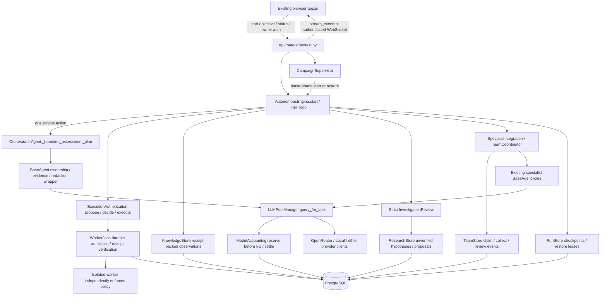

# Operational reliability baseline — 2026-11-15

This inventory applies to HEAD `1efbab4c6afd110a08b961fc3010562b130c84db` on `autonoms_pentesters`, including the six preserved dirty acceptance corrections. Local and remote branch HEAD match. The initial patch and file hashes are retained privately in `.local-lab/operational-reliability/initial-working-tree.patch` and `initial-baseline.json`. No remote write, reset, migration, paid call or worker modification was performed.

## Repository and deployment provenance (P00-01)

Six pre-existing modified files: `agents/autonomous_engine.py`, `tests/test_autonomous_intelligence.py`, `tests/frontend_contracts.cjs`, `web/index.html`, `web/static/scripts/app.js`, `web/static/styles/index.css`. Entry diff: 206 insertions / 18 deletions. These changes address historical objective delivery, persistent blockers, optional port restrictions, readable exact-bound approvals, stale cancellation UI and rejected-review privacy. They are preserved rather than attributed to this program.

Read-only service inspection returned active ARIA, PID 225979, working directory `/home/hryassin/PFA/pentest-ai-v10`, start `2026-11-14 19:32:41 UTC`. **The precise loaded source revision is unavailable:** the service exposes no immutable startup source fingerprint; current disk HEAD and process start time do not prove loaded Python module bytes. A restart was not performed to manufacture baseline provenance. P00-01 remains IN_PROGRESS until running-revision identification is resolved or explicitly audited as unavailable in final acceptance.

Correction after extended provenance inspection: the existing `X-ARIA-Build` header was initially overlooked. It is computed once at application import from backend Python source paths/bytes. Reconstructing HEAD in a disposable temporary directory gives `fd83a48ba1c4dad8`; applying only the preserved initial owner engine patch gives `e5da773393398091`, exactly the original service response. Fresh read-only remote HEAD still matches local HEAD. Private `baseline-build-candidates.json` / `live-build-observation.json` record this evidence. P00-01 is now VERIFIED for repository/process identification: the original backend uses the initial working-tree build and has not loaded this reliability program. The fingerprint excludes frontend/worker assets, is truncated and unsigned, and does not prove atomic import in the face of concurrent deployment; these limits remain explicit. The source-attested disposable graphical instance is a separate tested deployment.

The interrupted baseline test process completed successfully; its original session handle was polled after resumption rather than restarting it. Captured commands and elapsed wall times are in `baseline-checks.json` with logs in the same private directory. Python unittest reported **659 tests in 31.407s, OK**; wrapper wall time **34.187s** includes startup/shutdown. Node frontend contracts, budget-button contracts, JS syntax and Git whitespace checks passed. No source changes were made by this baseline cycle.

## Historical acceptance reconciliation (P00-02)

Authoritative historical sources: `reports/aria-live-autonomous-12-command-audit.html` and `.local-lab/live-autonomous-acceptance/{command-level-data.json,command-level-data.csv,report-summary.json,report-build-summary.json}`. The original baseline manifest has 7 entries and the artifact manifest has 44 entries: all exist and match their recorded SHA-256 hashes. Reconciliation output and input hash are retained in `.local-lab/operational-reliability/historical-reconciliation.json`.

| Historical observation | Structured evidence | Current interpretation |
| --- | --- | --- |
| Two tariff/approval blockers | First two runs: `blocked`, `model_tariff_missing`, 0 executed commands, 0 model calls | Legitimate missing approved tariff; no evidence of dispatcher bypass |
| Cancelled incompatible ports | Third run: `blocked` / reason `cancelled`, 0 commands, 1 physical model call | Historical UI reported cancellation separately from persisted generic blocked state; worker ceiling remained enforced |
| Invalid review response | Fourth run: `failed`, `run_error`, 2 commands, 3 model calls | Report recorded extra `alternative_explanforations`; old raw response not retained. Existing synthetic regression reproduces typo using harmless content and verifies strict rejection and private diagnostics |
| Successful bounded discovery | Fifth run: `completed`, 2 commands, 3 model calls, empty terminal reason code | `discovery` requires port discovery and HTTP response, not twelve commands. Completion concerns these observations; follow-up work remains proposals |
| Four worker operations | Four command rows, two per comparable paid arm | Not twelve-operation acceptance; no endurance inference |
| Three hypotheses / two proposals | Historical final review and research ledgers, referenced by report | Unverified research assertions; no confirmed vulnerabilities and no follow-up dispatch |
| Approval waiting / review latency | Final approval waits total 32300.051 ms; final review attempt wall 21774.622 ms | Different clocks/layers; model attempt wall includes accounting overhead; not pure provider latency |
| Model accounting | Seven attempts; 15756 reported tokens; $0.00032050116 reported charges; 324 rounded micro-USD; 2630 reserved micro-USD | Historical owner-approved ledgers only; no new spending assumed |
| Long-duration operation | No retained long-duration result in this acceptance | NOT_TESTED; short run is not operational readiness |

Historical defect root causes remain documented in the source report. Current regression checks are separate from historical visible acceptance. Fresh baseline passing tests establish that the preserved corrections do not fail those tests; they do not prove every reliability requirement.

## Actual call paths (P00-03)

This diagram is a source trace, not a claim that every edge was exercised in the historical paid run. Startup `api/main.py:lifespan` reconciles worker jobs, run checkpoints, team tasks and web actions before starting the campaign supervisor. One API worker is required; engine state, subscriptions and run tasks remain process-local.

| Component / responsibility | Source and runtime entry | Tests exercised in fresh 659-test baseline | Historical live evidence / limits |
| --- | --- | --- | --- |
| Autonomous engine: bounded observations, proposals, receipt processing | `agents/autonomous_engine.py`, API start/restore and supervisor `_start_or_restore` | autonomous evidence, context, intelligence, checkpoint suites | Two successful observations per paid arm; restart path not demonstrated there |
| Original objective / run and phase state | Browser `startAuto` → `AutonomousStartRequest` → `_start` → `SessionRunState` → `get_status` → RunStore checkpoint | frontend contracts, autonomous context, checkpoints | Initial objective lost by browser; corrected final checkpoint retained it. Loaded runtime bytes unidentified |
| Session state and owner isolation | `api/session_access.py`, `memory/session_manager.py`, authoritative execution context | access, isolation and authorization suites | Same-owner live runs; adversarial other-owner acceptance not performed |
| Task dependencies and ownership | `memory/team_tasks.py` materialize/transition/claim; `orchestrator/team_coordinator.py:run` | team tasks, specialist hardening/integration, campaign boundary | Not all named specialists called in standalone discovery; distinct analysis roles are in-process objects, not independent services |
| Existing agent roles | TeamCoordinator maps recon, scan, vuln, web_intel, correlation, report; coordinator interactive routing is separate | agent contracts, team tasks, specialist suites | Historical paid planner/reviewer attributed to orchestrator; no invented activity for unused agents. Post-access remains gated/stubbed |
| Research memory | `memory/research.py`: ingest_review/view/transition, application model revisions | research and lab research suites | Three persisted final hypotheses, two proposals reported; hypotheses remain unverified |
| Receipt-backed knowledge | `memory/knowledge_store.py`, deterministic parsers and worker receipt validation | knowledge store, parsers, evidence/checkpoint suites | Four successful normalized receipts; no model interpretation promoted to verified vulnerability |
| PostgreSQL persistence | `memory/database_models.py`, DecisionLog, AutonomousRun, campaign/session stores | Offline stores/mocks; actual SQL integration exists in `integration/test_*_postgres.py` | Historical owned SQL records exist; fresh disposable SQL checks NOT_TESTED in this cycle |
| LLM routing and strict responses | `agents/base_agent.py`, `agents/orchestrator_agent.py`, `llm/pool_manager.py`, provider clients, context-bound JSON schema | intelligence, provider transport, pool, accounting tests | Seven physical paid calls; observed provider schema violation despite requested strict schema |
| Budget accounting | `llm/engagement_budget.py`: reservation precedes provider I/O; durable settlement | engagement budget, tariffs, OpenRouter, campaign budgets | Historical charge/reservation reconciliation above; no new paid calls |
| Execution authorization | `memory/execution_authorization.py`, shared policy, command-bound one-use claim, scope/auth revision/epoch | execution, authorization store, campaign boundary and policy tests | Ordinary human approval used; no privilege change or bypass |
| Worker interface | `memory/worker_jobs.py`, `memory/worker_jobs.py:WorkerClient`, independent worker policy/runtime and closed adapters | worker server, resource, profiles, adapter contracts | Four bounded operations; current configured capabilities must be probed before fresh acceptance. Old documents describing only curl/Nmap predate typed adapter additions |
| Frontend state/event delivery | `web/static/scripts/app.js`: startAuto, stopAuto, handleAutoEvent; authenticated auto WebSocket in `api/routers/pentest.py` | VM-based Node contracts and dashboard checks | Visible historical screenshots and four matched result events; no stream-sequence proof against all reordered events |
| Campaign scheduler and recovery | `orchestrator/campaign_supervisor.py`, `memory/campaign_store.py`, campaign lease/execution guards | campaign, endurance and observability synthetic suites | Paid bounded acceptance does not demonstrate scheduled endurance or process crash recovery |
| Optional Redis/vector state | `memory/session_manager.py`, vector store/cache; authoritative ownership still SQL | cache/isolation fixtures | Exact current cache health NOT_TESTED; no dependency on cache as authority |

## Next defect investigations

1. Completed observation checks at the top of `_run_loop` skip the strict investigation review performed after execution. Crash reconciliation with complete observations may therefore complete without satisfying the same review condition. Explicit `invalid_review_output` checkpoints are non-restorable already; the defect is the unfinished-processing path. This was reproduced in two offline loop tests and corrected by a shared finalizer.
2. Successful runs previously left `reason_code` empty and final generic text could be `Run ended`; the shared finalizer now records `required_observations_completed` and its receipt-based reason. Broader mission/phase semantics remain under P01-02.
3. Existing cancellation uses `blocked` plus `cancelled`; state/UI contracts need a cross-component audit before introducing a new persisted terminal enum.
4. Strict local usage accounting uses default zeros when native provider usage fields are absent; investigate unknown-usage handling under P02-03.

No requirement beyond the evidenced baseline is marked verified by this inventory. Source presence and passing mock tests are not operational certification.
