# Coordination, persistence and memory evidence

This inventory concerns the tested working tree, with exact source manifests in the private evidence directory. Production PID 225979 has not been restarted. Synthetic provider responses demonstrate contracts and routing, not independent specialist expertise.

## Responsibility and completion

| Component | Input / state / output | Completion and evidence |
| --- | --- | --- |
| Browser and REST routes | Owned session, original objective, bounded goal, exact action decision | Forward objective unchanged; display persisted state and reconcile event gaps. They grant no extra execution authority. |
| `AutonomousEngine` | SessionRunState, current scope/auth revision/worker epoch, durable observation receipts | Dispatch only missing authorized observations; required review and optional configured specialist phase must finish before bounded-run completion. Two discovery observations can satisfy that bounded goal. |
| `orchestrator_agent` | Scoped planner context or receipt-bound review with strict JSON schema | Returns a validated proposal or unverified review; no model response itself authorizes execution. |
| `TeamCoordinator.run` | Owner/session/task ID, immutable task objective, dependencies, evidence input IDs, execution claim ID | Claims task once; validates campaign boundary before/after claim; routes the recorded owner_role; normalizes output to AgentResult and returns awaiting_review. Owner review is required for task completion. It dispatches no tool. |
| Recon / Scan / Web intelligence / Vulnerability | Distinct existing specialist entry points and role prompts, selected evidence and objective | Produce role-specific analysis/proposals through the common BaseAgent and strict public AgentResult. The deterministic benchmark uses a shared harmless model response, so it proves actual invocation/attribution, not independent reasoning quality. |
| Correlation | Current evidence-linked hypotheses, controls and uncertainty | Its responsibility is to challenge claims and missing controls. Model agreement grants no verification. Stale scope/model/evidence contexts are omitted. |
| Report | Owned saved records and uncertainty | Produces a report artifact through the existing deterministic report path; its benchmark invocation makes no model call. Report generation is not a mission-completion signal. |
| `TeamStore` | Owner-bound immutable events, task revisions, dependencies and source hashes | Serializes mutation and corresponding polling event in one engagement-locked transaction. Duplicate delivery returns the same claim/result and does not invoke a specialist again. |
| `ExecutionAuthorization` / `WorkerJobs` | Exact bound command, current policy, one-use approval, durable job ID | Authorization is consumed once. Worker admission and independent policy remain enforced. Unknown execution outcomes require reconciliation and are never automatically replayed. |
| Campaign supervisor | Durable campaign state, lease, schedule and budget | Owns campaign-bound runtime scheduling. A campaign task cannot acquire authority from a manual restore without its live supervisor lease. |

Specialist names are code roles. Historical bounded discovery demonstrated orchestrator planner/reviewer work and worker operations; it did not demonstrate six independent collaborating specialists. The twelve-operation fixture really invokes all six mapped roles (11 total specialist invocations; one task is cancelled before invocation). Post-access and unavailable profiles remain gated. No agent or tool was added to enlarge security-testing capability.

## Task-state and ownership evidence

```mermaid
stateDiagram-v2
    queued --> running: unique execution claim; dependencies complete
    queued --> blocked: prerequisite unavailable
    queued --> cancelled: owner cancellation
    running --> awaiting_review: attributed AgentResult accepted
    running --> blocked: interrupted or invalid result
    running --> failed: isolated specialist failure
    running --> cancelled: owner cancellation fences late result
    awaiting_review --> completed: owner review and completion criteria
    awaiting_review --> blocked: review rejects readiness
    awaiting_review --> cancelled: owner cancellation
    blocked --> queued: explicit owner retry
    blocked --> cancelled: owner cancellation
```

`tests/test_team_tasks.py`, `test_specialist_integration.py`, `test_specialist_hardening.py`, `test_research.py` and actual PostgreSQL `test_mission_state_postgres.py` cover identity, ownership, ordered dependencies, result attribution, stale revisions, conflicting transitions, cancellation, failure isolation and duplicate delivery. Five concurrent deliveries produce one specialist invocation. A cancelled task rejects a late result and cannot reappear active. Recovery turns an interrupted claim into a visible blocker; it does not reissue the operation.

The twelve-operation test uses actual SQL accounting, authorization/decisions, WorkerJobs, the worker ASGI service/policy, coordinator and specialists. Fixture transport starts no tool/container and forbids every non-database socket. Required outcomes are nine completed tasks, two cancelled and one blocked by malformed model output. Worker outcomes (ten success, one cancelled, one failure) remain separately recorded. A completed analysis task does not relabel a failed worker observation as a successful tool result.

## Measured communication baseline

The retained `sql-f3b8a2b5eb4a/twelve-operation-benchmark.json` baseline records 22 agent request/result messages, 14,449 serialized agent-input bytes, 21,059 output bytes, 33,137 model-input bytes and 4,437 repeated authoritative-context bytes. These are distinct boundaries and must not be added as independent network traffic. There are 877 SQL statements / 382,265 SQL statement-text bytes. Parameters, credentials and evidence contents are excluded from the SQL byte counter. Summed SQL request wall time is 2,407.24ms and can overlap other work; it is not database CPU or an additive decomposition of end-to-end latency.

Every operation retains correlation/job/task IDs, lifecycle events/revisions, evidence/source hashes, coordination duration, parse/validation samples and serialized payload sizes. Twelve heterogeneous operations do not justify a p95 per operation. Repeated identical full-batch endurance samples provide a separate, adequately sampled batch p95. No optimization or causal speedup is claimed from these measurements. Large-ledger and graph-heavy profiles remain a performance limitation, not a demonstrated bottleneck.

## Persistence and context quality

`AutonomousRun` stores revision/generation-fenced checkpoints. Engagement and run-row locks prevent stale writes, cross-session rebinding, changed objectives, lost evidence/accounting and terminal-state regression. Identical snapshot delivery is idempotent. Recovery preserves the forensic checkpoint while advancing the writer generation; old writers remain fenced. Event sequences and run identities protect the browser from stale terminals and duplicate approval controls.

The encrypted `investigation_review_state` journal records its owner/run/receipt binding before querying and the exact response before projection. A committed response is reused and strictly revalidated after restart. A missing provider outcome is unknown and blocks; it does not cause another logical review call. Actual child-process termination after committed research ingestion is tested in `integration/test_review_recovery_postgres.py`, followed by reconstruction in a fresh interpreter. Other SQL tests preserve completed/pending/cancelled work and deny foreign-owner access.

Memory has separate raw source observations, untrusted hypotheses, independently checked verification records and human review. `ResearchStore` binds hypotheses/application models to scope and evidence/model digests. Changed evidence, model revisions or scope invalidate context and require reopening/revalidation. `TeamCoordinator` now applies that same provenance check before specialist context, rather than merely matching evidence IDs. It sends at most three current related hypotheses, counts omitted stale/current entries, and retains the statement that these are untrusted research assertions. Evidence references are never expanded beyond assigned task inputs. A stored CONFIRMED state alone is not a fresh verification result.

The source-at-HEAD coordinator reproduced stale-context leakage in `stale-specialist-old-source.log` (one failing regression). Corrected memory/team/specialist checks passed 73 tests in 2.084s. The first reproduction fixture called nonexistent create_task and failed before reaching the defect; that unsuccessful experiment is retained separately, not presented as root-cause evidence. Mission research counts now separate recorded states from open proposals and explicitly decline to infer independent verification.

Full offline cycle6 passed 708 tests in 34.659s. SQL cycle5 passed 42 tests in 36.301s before the final stale-context change; the subsequent current-tree SQL cycle is recorded in PROGRESS.md. These results verify defined synthetic integrity contracts; they do not establish performance at production scale or live eight-hour readiness.
