# Mission state and continuity evidence

Scope: current authorized bounded objective and the owned engagement task ledger. This read model does not authorize execution, advance methodology phases or declare all future engagement work complete. HEAD is `1efbab4c6afd110a08b961fc3010562b130c84db` plus the retained dirty source; immutable source/log manifests are private evidence.

## Three separate questions

1. `completion.complete` / mission `observations_completed`: do recorded durable worker receipts satisfy the bounded observation goal? Discovery requires port discovery and an HTTP response; HTTP check requires an HTTP response. Two operations can satisfy discovery. This is unrelated to the twelve-operation software benchmark.
2. `run_state`: did the bounded engine finish its required review/processing? Both post-execution and restored complete-observation paths use the same finalizer. The receipt-bound accepted-review marker survives checkpoints. The encrypted review journal preserves the exact response before idempotent research ingestion. A claim with no recorded response blocks rather than issuing another logical model request.
3. `mission.state`: is work still recorded for this objective/engagement? A completed bounded run plus queued, running, blocked or awaiting-review team tasks remains `work_pending`. Failed and cancelled tasks remain visible. Completion requires an available valid task ledger and complete observation evidence. Optional research proposals never force execution.

The latest original objective remains separate from generated planner instructions and phase labels. Pending owned engagement tasks from earlier phases remain visible; projecting them does not replace the objective or renew their execution authorization.

## Operator-facing state matrix

| Evidence | Mission state | Meaning |
| --- | --- | --- |
| Engine planning or executing | running | Active bounded work |
| Exact proposal awaiting approval | waiting_for_approval | Human decision is required; no implicit approval |
| Required capability/prerequisite unavailable | blocked | Preserve exact recorded safe reason |
| Task/model/campaign/validation budget limit | budget_exhausted | Stop spending; retain completed work |
| Recorded pause intent and inactive interrupted run | paused | Pending work retained; no automatic replay |
| Cancellation requested, acknowledgement absent/false | cancellation_pending | Do not claim worker termination |
| Cancellation reason plus acknowledged termination | cancelled | Acknowledgement retained in checkpoint |
| Engine failure or completed run with failed tasks | failed | Do not promote partial work to successful completion |
| Bounded run completed, durable tasks unfinished | work_pending | Includes human review; agent return is not owner completion |
| Complete evidence, completed run, available ledger without unfinished/failed work | completed | Only the current bounded objective; no global readiness inference |
| Completed label with missing evidence or ledger | blocked | `completion_evidence_unavailable` / `task_ledger_unavailable`; unavailable is not empty |

Legacy raw run states remain compatible. `pause_requested` and `cancellation_confirmed` are strict optional checkpoint fields; old checkpoints default to unknown acknowledgement. A stop without a live loop now records a terminal cancellation reason rather than remaining indefinitely `cancelling`. Existing terminal history is preserved. Authorization revision and worker epoch changes stop before further proposals with explicit `authorization_changed` or `worker_epoch_changed` reasons.

```mermaid
stateDiagram-v2
    [*] --> running
    running --> waiting_for_approval
    waiting_for_approval --> running: exact human approval through existing gate
    running --> blocked: unavailable prerequisite or unknown outcome
    running --> budget_exhausted
    running --> paused: explicit graceful pause
    running --> cancellation_pending: owner stop
    cancellation_pending --> cancelled: acknowledged termination
    running --> failed
    running --> work_pending: bounded observations/process complete; team work remains
    work_pending --> completed: required results processed and owner review complete
    work_pending --> failed: recorded required task failure
    paused --> running: explicit authorized restore and reconciliation
```

This is a projection diagram, not a new dispatcher or permission graph. Every resume still passes the existing restore, ownership, receipt, scope, budget and execution authorization checks. No uncertain sensitive worker operation is repeated by the projection.

## Evidence

- `tests/test_mission_status.py`: operational state matrix; pending work and owners; optional research; unavailable/malformed ledger; incomplete evidence; failed/cancelled visibility.
- `tests/test_access.py`: actual status route with bounded completion and pending task; missing ledger; administrator run access does not expand owner-only team access; non-owner denial remains enforced.
- `tests/test_mission_continuity.py`: identical finalization on restore; strict rejected review; accepted receipt marker; final-step processing; no dispatch beyond budget; pause during/before review; cancellation acknowledgement without live loop; exact authorization-change reasons; cleanup context reset.
- `tests/test_checkpoints.py`: original objective/receipt marker roundtrip; legacy compatibility; malformed and foreign marker rejection; zero-step final processing; strict durable pause/cancellation acknowledgement.
- Real disposable SQL `integration/test_mission_state_postgres.py`: **3 tests in 6.128s OK**, `.local-lab/operational-reliability/sql-a4810f467e7f/`. Completed bounded run and pending task survive recovery and a fresh interpreter; repeated recovery creates no duplicate event; five concurrent deliveries invoke the synthetic specialist once; owner review controls completion; dependencies, foreign owner, cancelled late result and stale update are denied.
- Real review-journal SQL: **6 tests**, including actual child-process exit after committed ingestion, exact response reuse without another model request, unknown outcome blocking, concurrency, ownership, receipt binding, encryption/hash integrity and timeout retention. See `sql-b2ce07713a90/` and the combined five-suite runs.
- Final terminal-reason focused run: **92 tests in 3.458s OK**. Before corrections: 3 failing assertions across 11 continuity tests. Initial missing mission projection: 2 API errors before implementation.
- Workspace/dashboard Node contracts verify bounded wording, missing terminal status handling, actual pending count and unavailable count. Visible sandboxed Chromium launch is available, but graphical application acceptance remains NOT_TESTED.

## Open verification

P01-03 checkpoint/event consistency is verified by delayed-write, duplicate, invalid-transition, cross-session, generation, terminal-state and stop/start race regressions. The six-suite SQL run passed 41 tests (sql-281b453aaa69); cycle5 full offline passed 701 tests in 34.221s. Subscriber overflow retains the newest terminal event with a gap marker; clients reconcile gaps without renewing approvals and reject stale run/sequence events. One Uvicorn process remains required.

P05 now preserves safe tariff/accounting/budget and execution-gate denial codes, with component and operator action in the mission blocker projection. Worker constraint preflight remains open because the deployed capability response does not advertise its independent port ceiling. P04 must finish its broader data-integrity/memory-quality matrix. Twelve-operation and endurance validation remain separate. No implementation/test result here establishes deployment readiness.
